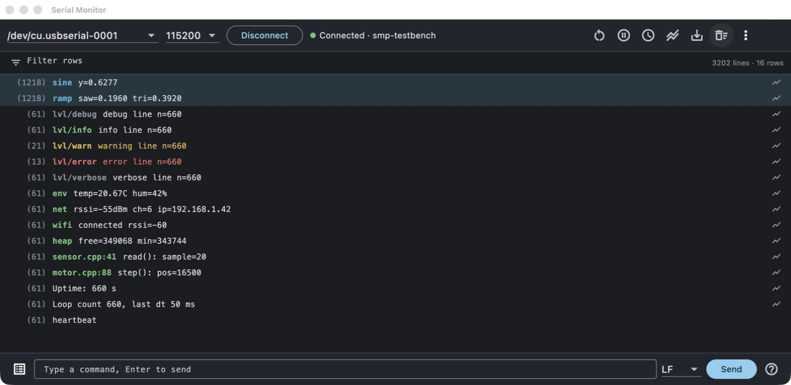
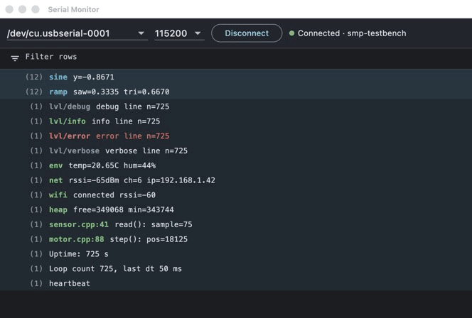
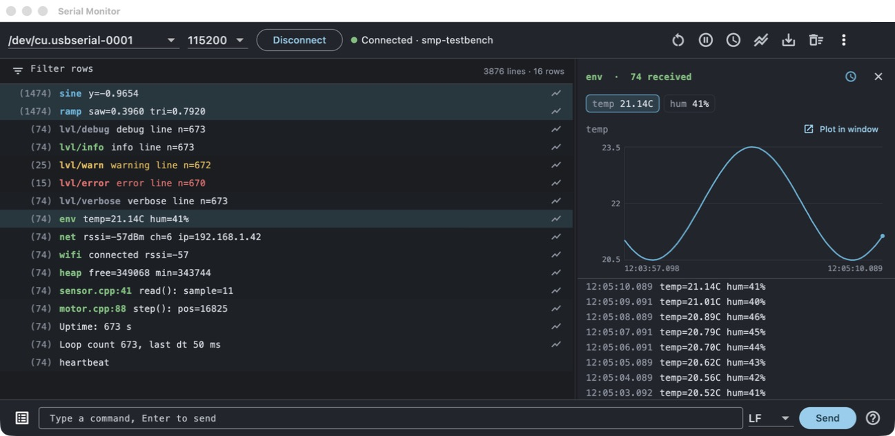
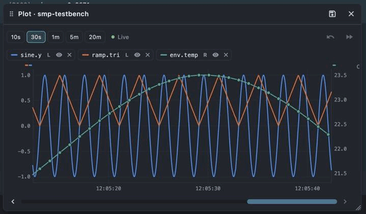
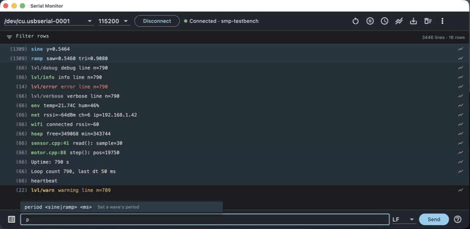
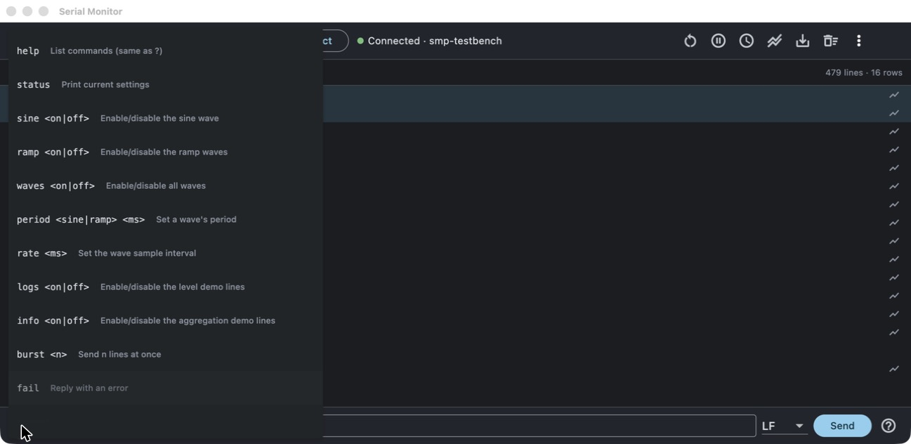

# Serial Monitor

**A serial monitor for ESP32 development that doesn't scroll everything past you.**

Every *kind* of message gets one row that updates in place, with a count of how
many have arrived. You can watch twenty things at once, click any of them to see
its history, graph any number in it, and send commands with autocomplete. It
also keeps working while you re-flash the board.

Desktop app for **macOS** and **Windows**.



## Contents

- [Download and install](#download-and-install)
- [Quick start](#quick-start)
- [Features](#features)
- [Making your firmware monitor-friendly](#making-your-firmware-monitor-friendly)
- [Re-flashing while the monitor is open](#re-flashing-while-the-monitor-is-open)
- [Building from source](#building-from-source)
- [Trying it with the test bench firmware](#trying-it-with-the-test-bench-firmware)

## Download and install

Get the latest build from the
[**Releases page**](https://github.com/richmr/SerialMonitor/releases/latest).

| Platform | File | Requires |
|----------|------|----------|
| macOS | `SerialMonitor-<version>-macos.dmg` | macOS 12 Monterey or later |
| Windows | `SerialMonitor-<version>-windows-x64.zip` | 64-bit Windows 10 or 11 |

> [!WARNING]
> **The builds are not code-signed.** Both macOS and Windows will warn you the
> first time you open the app. This is expected for a free hobby project without
> an Apple Developer ID or Windows signing certificate. It isn't a sign of
> tampering, but only download builds from this repository's Releases page.
> Each release is built by GitHub Actions from the tagged source and lists
> SHA-256 checksums in `SHA256SUMS.txt`. If you'd rather not run an unsigned
> binary, [build it yourself](#building-from-source).

### macOS

1. Open the `.dmg` and drag **Serial Monitor** into **Applications**.
2. Open it. macOS will say it *"cannot be opened"* or *"is damaged"*, or that
   Apple *"could not verify"* it. Click **Done** or **Cancel**, not **Move to
   Trash**.
3. Allow it in one of two ways:
   - **System Settings → Privacy & Security**: scroll down to the message
     about Serial Monitor, click **Open Anyway**, and confirm.
   - **Terminal**: remove the quarantine flag macOS puts on downloads:
     ```sh
     xattr -dr com.apple.quarantine "/Applications/Serial Monitor.app"
     ```
4. Open it again. You only have to do this once for each version you download.

### Windows

1. Right-click the downloaded `.zip`, choose **Properties**, tick **Unblock**
   and click **OK**. This step is optional, but it prevents most SmartScreen
   warnings.
2. Extract the zip anywhere, for example `C:\Tools\SerialMonitor`. Nothing gets
   installed.
3. Run `SerialMonitor.exe`. If SmartScreen says *"Windows protected your PC"*,
   click **More info**, then **Run anyway**.

Keep the `.exe` next to its DLLs and `data` folder. To make a shortcut,
right-click the `.exe` and choose **Pin to taskbar** or **Send to → Desktop**.

### USB drivers

Boards with a native USB port (ESP32-S2, S3, C3, C6) need no driver. Boards
with a USB-to-serial chip may need the chip vendor's driver, especially on
Windows: the
[CP210x driver](https://www.silabs.com/developers/usb-to-uart-bridge-vcp-drivers)
or the [CH340 driver](https://www.wch-ic.com/downloads/CH341SER_EXE.html).
If the port doesn't show up in the list, this is usually why.

## Quick start

1. Plug in your board. No firmware of your own yet? Flash the
   [test bench](#trying-it-with-the-test-bench-firmware) first.
2. Pick its port at the top left. ESP32-looking ports (Espressif, CP210x,
   CH340, FTDI) are listed first and one is preselected. The default is 115200
   baud.
3. Click **Connect**.

That's all you need. Any existing firmware works, with no changes. Lines are
grouped by their `[tag]`, ESP-IDF log tag, arduino-esp32 `file:line`, or
otherwise by their shape (numbers are ignored when comparing, so `Temp: 23.5`
and `Temp: 23.7` share a row). To make grouping exact and unlock command
autocomplete, see
[Making your firmware monitor-friendly](#making-your-firmware-monitor-friendly).

## Features

### One row per message, updated in place



- New text replaces the old text in a message's row, and the `(count)` in front
  goes up. Rows stay where they first appeared and flash briefly when they
  update.
- Errors are red, warnings are amber, and debug and verbose lines are dimmed.
- **Filter rows** narrows the view to rows that match what you type.
- **Hover** over a row to see when it first and last arrived. The clock button
  in the toolbar shows timestamps on every row.
- **Right-click** a row to copy or delete it. A deleted row comes back at the
  bottom if that message arrives again.
- When the device restarts, rows it hasn't sent since then are dimmed. You can
  have them cleared instead (⋮ menu → *Clear rows when the device restarts*).

### Click a row to see its history



Click a row to open a log of every time that message arrived, with timestamps.
Click any value in the log (here `temp`) to graph it. The chart icon on a row
is a shortcut that graphs the row's first value. Drag the divider to resize
the panel.

### Plot several values together



With a value graphed in the log panel, **Plot in window** opens a floating plot.
**Add to plot** overlays other values, up to 8.

- A value whose units or range don't fit the left axis gets a right-hand axis.
  Each legend entry has a button to move it between the **L** and **R** axes,
  an eye to hide it, and **×** to remove it.
- Window lengths: 10 s, 30 s, 1 min, 5 min or 20 min.
- Scroll back in time with the scrollbar or the scroll wheel. The view then
  stays put while new data keeps arriving. **⏩** returns to live.
- Drag across the chart to zoom in on a stretch, and press **↶** to go back.
  Hover for the values at that moment.
- **Save** stores the plot under the device's name, and it reopens by itself
  the next time that device connects. Each value keeps its most recent 50,000
  points.

### Send commands, with autocomplete



Type a command in the box at the bottom and press **Enter**. If the firmware
announces its commands (see below), they autocomplete as you type, and the
picker button on the left lists them all with their arguments and a
description:



The monitor asks a protocol-speaking device for its command list on its own
when it connects and after each restart. For firmware that can't announce its
commands, load a JSON description from ⋮ → *Load protocol file…*. The line
ending (LF, CR, CRLF or none) is selectable next to **Send**.

### Everything else

- **Save the stream**: the download button saves every line received and sent,
  with timestamps. The last 200,000 lines are kept in memory. For longer
  captures, use ⋮ → *Record serial stream to file…*, which writes each line as
  it arrives until you stop it.
- **Restart the board**: the ↻ button pulses EN through RTS, the same way the
  auto-reset circuit does.
- **Serial settings**: baud rate is next to the port. DTR and RTS are in the ⋮
  menu. The defaults are 8N1, no flow control, with DTR and RTS asserted, which
  leaves the auto-reset circuit idle.
- **Zoom**: <kbd>Cmd</kbd> <kbd>+</kbd> / <kbd>−</kbd> / <kbd>0</kbd> on macOS,
  <kbd>Ctrl</kbd> on Windows.

## Making your firmware monitor-friendly

The monitor reads plain text, so your firmware's output still looks normal in
`pio device monitor` or any other terminal. Following a few conventions lets the
monitor group lines exactly and know what commands the device takes. These
conventions are called **SMP** (Serial Monitor Protocol):

```text
[env] temp=23.5C hum=41%          ← one row per tag; every number can be graphed
[motor:W] stall detected pos=1200 ← :E / :W / :I / :D / :V sets the level
[!hello] smp=1 name="BenchTest" fw="0.3.1"
[!cmd] name=move args="<steps> [speed]" desc="Move the stepper"
```

**[docs/PROTOCOL.md](docs/PROTOCOL.md)** is the full specification.

You don't have to format these lines by hand. For Arduino or PlatformIO
firmware, use the header-only helper in
[`esp32/SerialMonitorProtocol`](esp32/SerialMonitorProtocol):

```cpp
#include <smp.h>

void onLed(const char* args) { /* "on" or "off" */ }

void setup() {
  Serial.begin(115200);
  smp::begin(Serial, "my-device", "1.0.0");                    // sends [!hello]
  smp::command("led", "<on|off>", "Switch the LED", onLed);    // announces [!cmd]
}

void loop() {
  smp::poll();                                                 // runs commands
  smp::log("env", "temp=%.1fC hum=%d%%", readTemp(), readHum());
}
```

Add it to a PlatformIO project with
`lib_deps = symlink:///path/to/SerialMonitor/esp32/SerialMonitorProtocol`, or
copy `smp.h` into your project.

Two examples are included:

- [`esp32/examples/basic`](esp32/examples/basic): a minimal sketch.
- [`esp32/examples/testbench`](esp32/examples/testbench): test firmware that
  exercises every feature. It sends graphable waves, every log level, and each
  line format the monitor groups, and it has commands to change all of them. It
  is what produced the screenshots above. Type `help` once it's connected.

## Re-flashing while the monitor is open

You don't need to close the monitor to upload new firmware.

- **Auto-reconnect.** If the port disappears or errors (because of a reset, an
  unplugged cable or a native-USB board re-enumerating), the monitor shows
  *Waiting for device…* and reopens the port as soon as it comes back.
- **PlatformIO upload hook.** A USB-to-serial chip never disappears, and on
  Windows only one program can hold a COM port, so the uploader needs the
  monitor to let go of it. Add this line to your firmware project's
  `platformio.ini`:

  ```ini
  extra_scripts = post:/path/to/SerialMonitor/tool/pio_smp_hook.py
  ```

  Before `pio run -t upload`, the hook asks the monitor (over TCP on
  `127.0.0.1:47800`) to release the port, and afterwards to take it back. If an
  upload fails partway, the monitor takes the port back on its own after
  120 s.
- **By hand.** The ⏸ button releases the port and ▶ takes it back.

## Building from source

You'll need Flutter 3.22 or newer, plus Xcode on macOS or Visual Studio with
*Desktop development with C++* on Windows.

```sh
flutter test
flutter run -d macos      # or: flutter run -d windows
```

- First time using Flutter? Start with [docs/MAC_SETUP.md](docs/MAC_SETUP.md)
  or [docs/WINDOWS_SETUP.md](docs/WINDOWS_SETUP.md).
- To make your own `.dmg` or `.zip`, see
  [docs/PACKAGING.md](docs/PACKAGING.md).
- For how the code is laid out, see
  [docs/DEVELOPMENT.md](docs/DEVELOPMENT.md).

Bug reports and pull requests are welcome. When reporting a bug, it helps to
attach a short stream capture (⋮ → *Save serial stream…*) that shows the
problem.

## Trying it with the test bench firmware

[`esp32/examples/testbench`](esp32/examples/testbench) is a PlatformIO project
that exercises every feature of the monitor, so you can try it out (or check a
change) without writing any firmware.

1. Deploy it to your board with
   [PlatformIO](https://docs.platformio.org/en/latest/core/quickstart.html#process-project).
   The default environment is a classic ESP32 (`esp32dev`). Use `-e esp32-s3`
   or `-e esp32-c3` for boards with a native USB port.
2. Connect to the board in Serial Monitor, as in the
   [Quick start](#quick-start).
3. Rows for waves, log levels and the different line formats appear and start
   updating. Type `help` in the command box to list the commands that change
   them.

The project already includes the [upload hook](#re-flashing-while-the-monitor-is-open),
so you can re-flash it while the monitor is connected.

## License

[MIT](LICENSE) © 2026 Mike Rich
